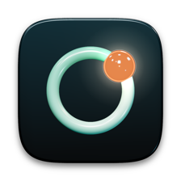
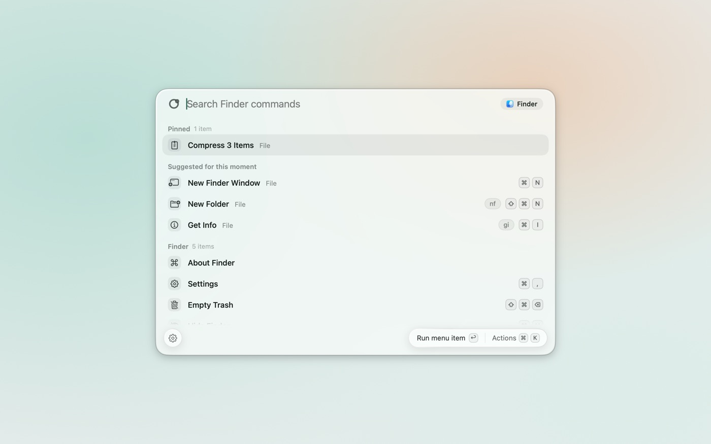
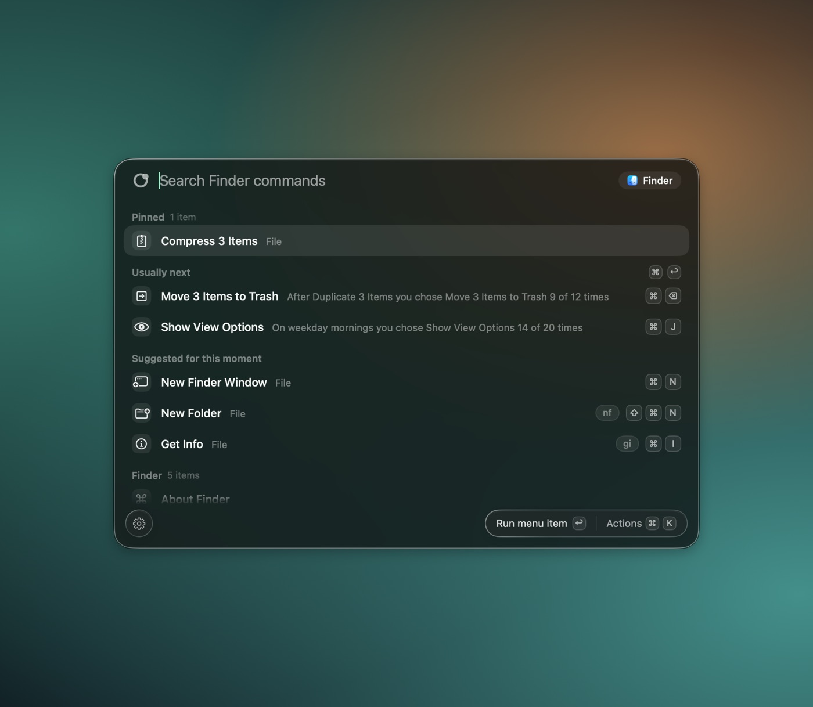
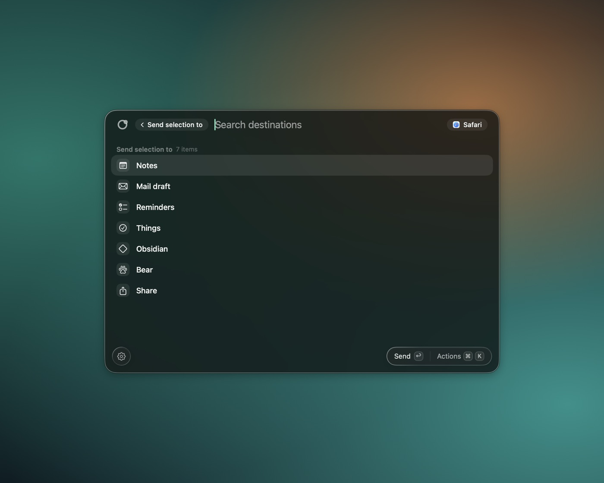

<div align="center">



# Apropos

**A command palette for the Mac that knows what you are doing.**<br>
One hotkey opens a fast panel that reads the app in front of you, your selection and the page or document you have
open, and lists the actions that fit that moment.

[](https://github.com/Zawalid/Apropos/actions/workflows/ci.yml)
[](LICENSE)


[Website](https://apropos.zawalid.com) &nbsp;·&nbsp; [Install](docs/install.md) &nbsp;·&nbsp; [How it stays private](#how-it-stays-private) &nbsp;·&nbsp; [Build from source](#build-from-source) &nbsp;·&nbsp; [Docs](#docs) &nbsp;·&nbsp; [Roadmap](docs/roadmap.md) &nbsp;·&nbsp; [Changelog](CHANGELOG.md)

<br>

<picture>
  <source media="(prefers-color-scheme: dark)" srcset="docs/images/palette-dark.jpg">
  
</picture>

</div>

<br>

## What it is

Apropos is a native macOS menu bar app. Press Option-Space and a floating panel opens on the screen you are using.
It lists the menu commands of the app in front, plus actions for the text, files, page or folder you have selected,
your own commands, and a "send this to..." layer for Notes, Reminders, Mail and more. It is keyboard first, runs
fully on your Mac, and learns which command you usually run next, from command names and times only. It sits next to a
launcher such as Raycast rather than replacing it: it does not launch apps, search files or manage the clipboard.

The name is the French word for "fitting the moment". The project was called Cue until shortly before its first
public source release.

## Status

Apropos is early. There is no release yet.

- There is no downloadable build. Today you build it from source, see below.
- The first builds will not be notarized, because there is no Apple Developer account behind the project yet. macOS
  will ask you to confirm the first launch. [docs/install.md](docs/install.md) says exactly how and why.
- Automatic updates are not wired up yet.
- Recording a command by doing it once is a first version and has not been verified on a real Mac yet. See
  [docs/recorder-plan.md](docs/recorder-plan.md). Treat it as experimental.
- Settings and file formats can still change before 1.0.

What is shipped and what is not is tracked in [CHANGELOG.md](CHANGELOG.md), nothing else is claimed here.

## What it does

<table>
<tr>
<td width="50%" valign="top">

**The menu bar of the app in front**<br>
Every command of the frontmost app's menus, with shortcuts and enabled or checked state, fuzzy search, and Return runs
the item through the Accessibility API. Any menu item can get its own alias and its own global shortcut.

</td>
<td width="50%" valign="top">

**Context actions**<br>
Apropos reads, only when the panel opens, the selected text, selected files, the web address or document of the
front window, the folder and the git branch. Actions that fit show up first, whether or not the app has a menu item
for them.

</td>
</tr>
<tr>
<td width="50%" valign="top">

**Send to**<br>
Send a selection, a page, files or a folder to Notes, Reminders, Things, Obsidian, Bear, a Mail draft (it never
sends), a remembered folder, or the system Share menu. Each shows only when its app is installed.

</td>
<td width="50%" valign="top">

**Your own commands**<br>
A command is a link, a Shortcut or a program you define once. Run it from the panel, its own key, an
`apropos://` link or Shortcuts. A command must be approved before it runs, and values passed in from outside can never
become program text. See [docs/integrations.md](docs/integrations.md).

</td>
</tr>
<tr>
<td width="50%" valign="top">

**Sequences**<br>
Chain steps of different kinds into one command, with the result of each step passed to the next. Anything that
leaves a trace outside Apropos is listed in one confirmation before the first step.

</td>
<td width="50%" valign="top">

**Usually next**<br>
Apropos learns on your Mac which command you run after which, and offers it with the reason: "After Run Tests you chose
Commit 9 of 12 times". It learns names, apps and times, never selections, addresses, document names or queries.

</td>
</tr>
<tr>
<td width="50%" valign="top">

**Recording (experimental)**<br>
Do something once in the menus of an app and review it as a list of steps before it is saved as a command. It asks
for Accessibility and Input Monitoring only when you start, and records intent, never what you type.

</td>
<td width="50%" valign="top">

**Built for the Mac**<br>
Native SwiftUI and AppKit, a menu bar popover, a Settings window, onboarding, light and dark, and Liquid Glass on
macOS 26. No account, no analytics, no server.

</td>
</tr>
</table>

<br>

<table>
<tr>
<td width="50%"></td>
<td width="50%"></td>
</tr>
</table>

The data in these pictures is sample data. The command lists are real menu bars read from installed apps.

## How it stays private

Nothing about your screen, selection or documents leaves your Mac. Specifically:

- **No network use.** There is no account, no analytics and no crash reporting, and the app makes no network
  connections. Update checks are off. The Privacy and data page of Settings shows the current network state.
- **Reads on demand.** The app in front is read when you open the panel, not continuously, and never while it is
  closed. Apps on a privacy list, password managers among them, are not read.
- **Small, readable files.** Everything is kept as plain files in `~/Library/Application Support/Apropos/`: your
  settings, your commands, usage counts and the order commands were run in. Settings has Reveal, Forget and
  Export all my data for each.
- **Only what a feature needs.** Accessibility is required for the panel. Input Monitoring is asked for only if you
  record a command. macOS asks for Automation the first time one of your commands controls another app.

The full threat model, including what a malicious link or a hostile app could try, is in [SECURITY.md](SECURITY.md).

## Install

There is no release to download yet. Build it from source with the steps below, or follow
[docs/install.md](docs/install.md), which also covers what to do on the first launch of an app that is not notarized.

Requirements: macOS 14 or later to run, and Xcode 26 or later to build (the app uses Liquid Glass when it runs on
macOS 26).

## Build from source

```bash
git clone https://github.com/Zawalid/Apropos.git
cd Apropos
brew install xcodegen
(cd App && xcodegen generate)
xcodebuild build -project App/Apropos.xcodeproj -scheme Apropos -configuration Release \
  -derivedDataPath build/release CODE_SIGN_IDENTITY="-"
open build/release/Build/Products/Release/Apropos.app
```

The first launch asks for Accessibility access. A build signed ad hoc, as above, gets a new signature every time you
rebuild, and macOS ties the Accessibility grant to the signature. If you rebuild often, sign with a stable certificate
(see [docs/development.md](docs/development.md)).

To work on the code instead, use the fast loops in [CONTRIBUTING.md](CONTRIBUTING.md): live previews in Xcode that need no
launch and no permissions, `scripts/dev.sh` to rebuild and relaunch, and `swift test` for the unit tests, which
run against fixtures and never against a live app.

## Project layout

| Path | What is in it |
|---|---|
| `Sources/Apropos` | the core library, no UI: menu reading, search and ranking, context, actions, sequences, recorder, data |
| `Sources/apropos-probe` | a command line tool that lists or presses an app's menu commands, for debugging |
| `Tests/AproposTests` | unit tests, using fixtures and fakes |
| `App/AproposApp` | the SwiftUI and AppKit app: panel, Settings, onboarding, menu bar |
| `App/project.yml` | the XcodeGen definition; `App/Apropos.xcodeproj` is generated and not committed |
| `scripts` | `dev.sh` (rebuild and relaunch), `render-previews.sh` and `shots.sh` (pictures without launching the app) |
| `docs` | design notes and reference, indexed below |

## Docs

| | |
|---|---|
| [design.md](docs/design.md) | what Apropos is for and what it will not do |
| [roadmap.md](docs/roadmap.md) and [backlog.md](docs/backlog.md) | what is built and what is next |
| [development.md](docs/development.md) | previews, the dev loop, signing, tests |
| [install.md](docs/install.md) | install, the first launch without notarization, uninstall |
| [releasing.md](docs/releasing.md) | how a release is meant to be cut (draft) |
| [context-actions.md](docs/context-actions.md), [ranking.md](docs/ranking.md), [prediction.md](docs/prediction.md) | how the panel decides what to show |
| [user-commands.md](docs/user-commands.md), [integrations.md](docs/integrations.md), [destinations.md](docs/destinations.md), [sequences.md](docs/sequences.md) | commands, links, Send to, sequences |
| [recorder.md](docs/recorder.md), [ui-steps.md](docs/ui-steps.md) | recording and replaying steps |
| [data-layer.md](docs/data-layer.md), [settings-file.md](docs/settings-file.md) | what is stored, and where |

## Contributing

Issues and pull requests are welcome. Read [CONTRIBUTING.md](CONTRIBUTING.md) first, and follow the
[code of conduct](CODE_OF_CONDUCT.md). For security problems, do not open a public issue: see [SECURITY.md](SECURITY.md).
Questions and ideas fit in [Discussions](https://github.com/Zawalid/Apropos/discussions).

## License

[MIT](LICENSE), copyright 2026 Walid Zakan.

The license covers the code and documentation. The name "Apropos", the app icon and the logo ring are not licensed for
use in other products or to suggest that a fork or a derived app is the official one. A fork is welcome to be a fork:
please give it its own name and icon.
